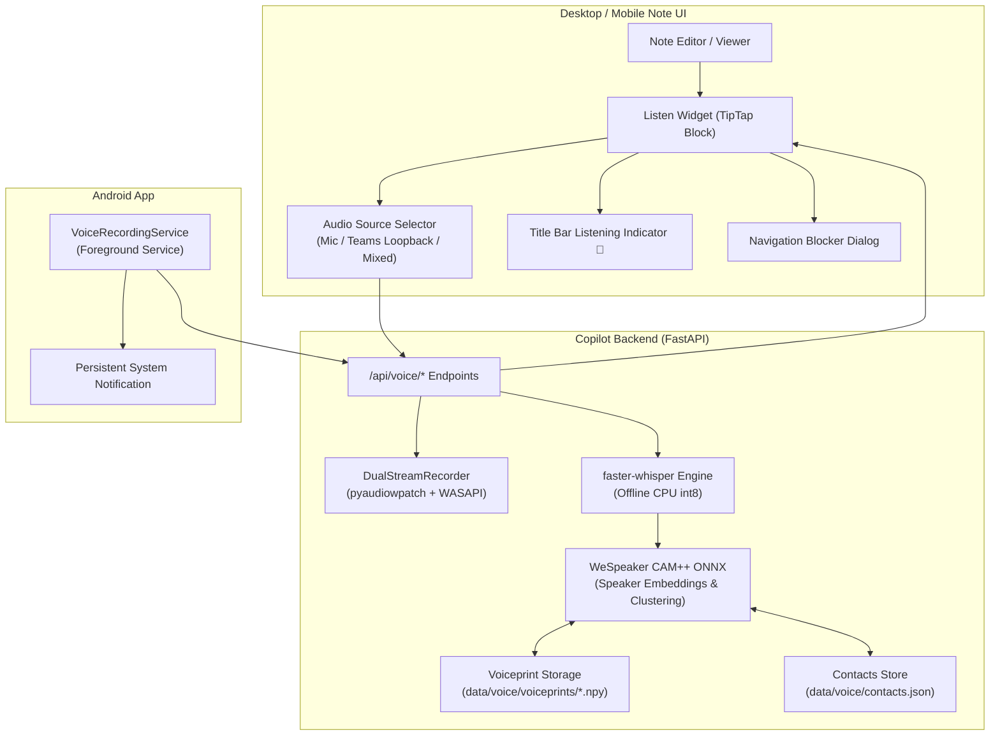

# Implementation Plan — Phase 13: Voice Notes & Meeting Transcription Widget (First Mate Integration)

## Overview & Task Goal
Refactor and integrate the audio capture, offline speech-to-text (Whisper), and neural speaker diarization (WeSpeaker CAM++) capabilities from **First Mate** (`C:\Users\designer\Documents\assistant\first-mate`) directly into the **Daily Co-Pilot** system as an interactive, note-embedded widget.

The user will be able to:
1. Open or create any note in Daily Copilot.
2. Insert a listening/transcription widget into the note (via `/listen` slash command or toolbar).
3. Select an audio source (Default Microphone, System Audio / Teams Call Loopback, or Mixed).
4. Click **Start Listening** to capture high-fidelity audio.
5. Click **Stop** to automatically transcribe offline via `faster-whisper` and display speaker-attributed dialogue in a collapsible section within the widget.
6. Automatically identify known speakers via enrolled voiceprints, or manually listen to audio snippets of unknown participants, assign names/aliases, and enroll their voiceprints with one click.
7. Use the Daily Copilot AI Assistant to instantly extract meeting summaries, action items into tasks, or design decisions directly from the note.

---

## Strict Constraints & Requirements

### Desktop Version Requirements
1. **Single Active Widget Enforcement**: Never allow multiple widgets to run simultaneously anywhere in the application. Starting a recording in one widget must lock/disable other widgets and backend sessions.
2. **Navigation Interception & Prompt**: When navigating away from a note with an active "listening" widget:
   - Automatically prompt the user for confirmation: *"Voice recording is currently active. Leaving this note will stop listening and finalize the transcription."*
   - Suggest: *"Tip: Open the new view in a new window to keep recording."*
   - Offer options: **Stay on Page**, **Stop & Leave**, or **Open in New Window**.
3. **Title Bar / Header Indicator**: Display a visible recording icon/badge in the title bar / header (e.g. `🔴 Listening (MM:SS)`) while audio capture is active, and update `document.title`.

### Mobile Version Requirements
1. **Persistent Notification**: While listening, the Android app must run an Android foreground service with a persistent ongoing notification in the system tray (`Daily Copilot: Listening... [Stop]`).

---

## Architecture & Data Flow



---

## Proposed Changes & File Modifications

### 1. Backend (`backend/`)

#### A. Voice Engine & Speaker Diarization Module (`backend/voice.py`)
Port and refactor from `first-mate/app/recorder.py`, `transcriber.py`, and `contacts.py`:
- **DualStreamRecorder**:
  - WASAPI loopback capture + local microphone capture using `pyaudiowpatch`.
  - Resample and downmix int16 PCM streams to 16kHz mono WAV for Whisper.
  - Expose device query helper (`list_audio_devices()`) to enumerate mics and system loopback devices.
- **Whisper Transcriber**:
  - Load cached `faster-whisper` model (`base.en` default, configurable to `tiny.en` or `small.en`).
  - Run VAD filter (`min_silence_duration_ms=500`).
- **Speaker Diarizer & Voiceprint Matcher**:
  - Copy and reference `wespeaker_en_voxceleb_CAM++.onnx` in `backend/models/`.
  - Extract 80-bin Mel Filterbank features, compute 512-dim L2-normalized embeddings using ONNX runtime.
  - Agglomerative hierarchical clustering to segment speaker turns.
  - Compare cluster embeddings against enrolled voiceprints in `backend/data/voice/voiceprints/` (cosine similarity threshold 0.72).
  - Extract 2-5s audio snippets for untagged speakers into `backend/data/voice/snippets/`.
  - `apply_participant_tag()`: Save new voiceprint, update contacts, and replace speaker placeholders in markdown notes.

#### B. API Endpoints (`backend/main.py`)
Add routes under `/api/voice`:
- `GET /api/voice/devices`: Returns available microphones and system loopback devices.
- `POST /api/voice/recording/start`: Start recording session with chosen device. Return 409 if session active.
- `GET /api/voice/recording/status`: Returns `{is_recording: bool, elapsed_seconds: float, source: str}`.
- `POST /api/voice/recording/pause` / `POST /api/voice/recording/resume`: Pause/resume session.
- `POST /api/voice/recording/stop`: Stops capture, transcribes, diarizes, and returns structured result:
  ```json
  {
    "status": "completed",
    "duration": 48.5,
    "audio_url": "/api/voice/audio/voice_20261018_130000.wav",
    "audio_file": "voice_20261018_130000.wav",
    "participants": [
      {"speaker_id": "Participant 1", "display_name": "Alice", "is_tagged": true, "email": "alice@spirityachts.com"},
      {"speaker_id": "Participant 2", "display_name": "Participant 2", "is_tagged": false, "cluster_id": 2, "audio_stem": "voice_20261018_130000", "snippet_url": "/api/voice/snippets/voice_20261018_130000_participant_2.wav", "sample_text": "Let's review the frame 12 calculations."}
    ],
    "dialogue": "[00:00 - 00:15] **Alice:** Hello...\n\n[00:16 - 00:30] **Participant 2:** Let's review the frame 12 calculations.",
    "full_text": "Hello... Let's review the frame 12 calculations."
  }
  ```
- `POST /api/voice/transcribe`: Direct upload endpoint for WAV/M4A files (from Android or file picker).
- `GET /api/voice/audio/{filename}`: Stream recorded WAV file.
- `GET /api/voice/snippets/{filename}`: Stream speaker snippet WAV.
- `POST /api/voice/tag-participant`: Tag an untagged participant, enroll voiceprint, and update note content.

---

### 2. Desktop Frontend (`desktop/`)

#### A. Markdown Format & TipTap Extension (`desktop/src/components/noteFormatting.ts`)
- Add `ListenBlock` node extension supporting ````listen ... ```` fenced blocks:
  ```listen
  {"status":"completed","duration":48.5,"audio_file":"voice_20261018_130000.wav","dialogue":"...","participants":[...]}
  ```
- Register `ListenBlock` in `NoteEditor.tsx` and `NOTE_COMPONENTS` in `NotePage.tsx`.

#### B. Note Widget UI (`desktop/src/components/ListenWidget.tsx`)
- Render widget in both edit and read-only modes:
  - **Idle State**:
    - Source dropdown: Default Microphone, WASAPI Loopback (Teams/Calls), Mixed.
    - Big primary button: **Start Listening** with mic icon.
  - **Listening State**:
    - Pulsing red indicator dot, elapsed time counter (`MM:SS`).
    - Audio waveform / activity animation.
    - **Stop** and **Pause / Resume** buttons.
  - **Processing State**:
    - Progress spinner with status text: *"Transcribing with Whisper..."*, *"Diarizing speakers..."*.
  - **Completed State**:
    - Audio playback bar (mini audio player to replay recording).
    - **Collapsible Transcript**: Expand/collapse toggle for speaker dialogue.
    - **Participants Panel**:
      - Tagged speakers with green badge.
      - Untagged speakers with audio snippet play button, name input, and **Tag & Enroll** button.
    - **AI Assistant Actions**:
      - "Summarize Meeting", "Extract Action Items into Tasks", "Extract Decisions".
      - Clicking opens Copilot Chat with a pre-populated prompt targeting the note.

#### C. Global Recording State & Navigation Blocker
- `desktop/src/context/VoiceRecordingContext.tsx`:
  - Tracks single active recording instance across the entire application.
  - Locks out all other widgets when one is active.
- `desktop/src/pages/NotePage.tsx`:
  - Navigation interception: Detects attempts to navigate away while recording is active.
  - Modal prompt:
    - *"Voice recording is active on this note. Leaving this note will stop listening and finalize the transcription."*
    - Options: **Stay on Page**, **Stop & Leave**, **Open in New Window** (suggesting new window to preserve recording).
- `desktop/src/components/PageHeader.tsx` & `desktop/src/components/Layout.tsx`:
  - Show header pill/badge `🔴 Listening (MM:SS)` when active.
  - Update `document.title` to include recording status.

#### D. Slash Command & Toolbar Insertion
- Add `/listen` slash item in `desktop/src/components/slashCommand.tsx`.
- Add microphone icon button in `desktop/src/components/NoteEditor.tsx` toolbar.

---

### 3. Mobile Companion App (`android/`)

#### A. Android Permissions & Service
- In `android/app/src/main/AndroidManifest.xml`:
  - Add `RECORD_AUDIO`, `FOREGROUND_SERVICE`, `FOREGROUND_SERVICE_MICROPHONE`, `POST_NOTIFICATIONS`, `WAKE_LOCK`.
- In `android/app/src/main/java/com/bespoke/copilot/VoiceRecordingService.kt`:
  - Implement foreground service running `MediaRecorder` or `AudioRecord`.
  - Create `NotificationChannel` with high priority.
  - Persistent ongoing notification: `Daily Copilot: Listening... [Stop Recording]`.
  - When stopped: write audio to storage, upload to `/api/voice/transcribe`, and attach to note.

---

## Verification & User-Driven Testing Plan

### Automated Verification
1. **Backend Tests**:
   - Run `pytest backend/tests/test_voice.py` to verify:
     - Audio device enumeration.
     - Single active recording lock (second start returns 409).
     - Transcription pipeline mock.
     - Speaker embedding & voiceprint matching logic.
     - Participant tagging & frontmatter/dialogue renaming.
   - Run full regression: `pytest backend/tests/`.
2. **Frontend Type & Build Checks**:
   - `npm run build` in `desktop/` to verify TypeScript compile and bundling with no errors.

### Manual, User-Driven Testing Strategy (Hands-On Verification)
1. **Launch Environment**:
   - Start backend (`python -m uvicorn main:app --reload --port 8000`) and desktop client (`npm run dev`).
2. **Widget Insertion**:
   - Open Daily Copilot desktop in the browser (`http://localhost:5173`).
   - Open or create a new note (e.g. `Test Voice Note`).
   - Type `/listen` or click the microphone icon in the editor toolbar.
   - Verify the `ListenWidget` appears in the note with audio source options.
3. **Audio Capture & Single-Widget Lock**:
   - Select default microphone and click **Start Listening**.
   - Verify the title bar displays the `🔴 Listening (MM:SS)` badge and live duration counter.
   - In another browser tab or another note, verify attempting to start another widget is blocked.
4. **Navigation Interception**:
   - While the widget is listening, click a link in the sidebar to another note or task list.
   - Verify the modal appears warning that leaving will stop listening, and recommending opening in a new window.
   - Click "Stay on Page" -> verify recording continues uninterrupted.
5. **Stop & Transcription**:
   - Click **Stop** in the widget.
   - Verify the widget shows transcription progress and finishes with the audio player and collapsible transcript.
   - Click to expand the transcript and verify spoken words and speaker labels appear.
6. **Participant Identification**:
   - Verify any untagged participant shows an audio sample button.
   - Click the play button to hear the snippet.
   - Enter a name (e.g. `Alice`) and click **Tag & Enroll**.
   - Verify the transcript updates in place to `Alice` and her voiceprint is enrolled.
7. **Assistant Integration**:
   - Click "Summarize Meeting" or "Extract Action Items" on the widget.
   - Verify the Copilot Chat pane opens with the synthesized prompt and produces structured meeting notes or tasks.
8. **Mobile Notification Check**:
   - Verify `VoiceRecordingService` starts foreground notification when triggered on Android device.
