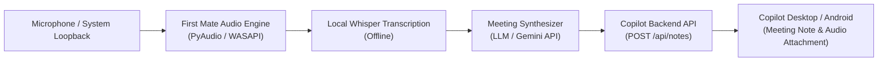

# Implementation Plan: Integrate AI Voice Note Taking (First Mate) into Copilot

## Overview
Integrate the voice recording, offline audio transcription (Whisper), and meeting synthesis capabilities from **First Mate** (`C:\Users\designer\Documents\assistant\first-mate`) directly into the **Copilot** workspace, allowing users to record meetings, transcribe audio, generate structured meeting minutes, and save them automatically as notes within spaces.

---

## Architecture & Integration Points

---

## 1. Backend Integration (`backend/`)

1. **Audio Recording & Transcription Service**:
   - Port or bridge the core recording and Whisper transcription logic from `first-mate/` into `backend/services/voice.py`.
   - Support selecting input audio devices (microphone + WASAPI system loopback for Teams/calls).
   - Support Whisper model selection (`tiny.en`, `base.en`, `small.en`) with offline private processing.

2. **API Endpoints**:
   - `POST /api/voice/recording/start`: Start audio capture session with target space and meeting metadata (project, attendees, vessel).
   - `POST /api/voice/recording/pause` / `POST /api/voice/recording/resume`: Pause/resume current recording session.
   - `POST /api/voice/recording/stop`: Stop capture, trigger Whisper transcription, and run synthesis.
   - `GET /api/voice/devices`: Enumerate available microphones and audio loopback devices.
   - `POST /api/voice/transcribe`: Endpoint to transcribe uploaded audio files directly.

3. **Automatic Note Creation**:
   - Automatically format transcribed meeting minutes into standard Markdown with frontmatter (`title`, `date`, `project`, `attendees`, `action_items`).
   - Store the generated file in the active space's `content/` directory via `file_layer.py`.
   - Automatically link any action items discovered during synthesis into Copilot tasks (`POST /api/tasks`).

---

## 2. Desktop Frontend Integration (`desktop/`)

1. **Header / Tray Quick-Record Widget**:
   - Add a microphone / recording toggle button in the desktop header or bottom status bar.
   - Visual indicator showing live recording state (recording dot 🔴, elapsed duration, waveform/VU meter).
   - Quick meeting modal to set Topic, Project tag, and attendees.

2. **Meeting Notes View / Integration**:
   - When a recording completes, open the newly created note immediately in `NotePage.tsx`.
   - Embed audio playback player for the recording with synchronized transcript highlighting.

3. **Space Preferences Settings**:
   - Add a "Voice & Transcription" section under Space Preferences:
     - Default Whisper model (`tiny.en` vs `base.en`).
     - Preferred microphone and loopback audio toggle.
     - Custom meeting synthesis prompts and templates.

---

## 3. Mobile / Android Companion App (`android/`)

1. **Voice Note Recording Screen**:
   - Integrate phone mic recording for quick mobile voice notes on the walk (using existing Android audio recording service).
   - Stream or sync recorded audio to the Copilot backend server.
   - Transcribe and append to notes or create new voice meeting notes.

---

## Verification & Rollout Plan

1. **Unit & Integration Tests**:
   - Backend tests for `/api/voice/*` endpoints with mock audio files.
   - Verify synthesized notes match template schemas and correctly parse action items into tasks.
2. **Desktop UI Verification**:
   - Verify microphone enumeration, recording state machine (start, pause, stop).
   - Verify generated `.md` note appears in the Content sidebar under the corresponding project folder.
